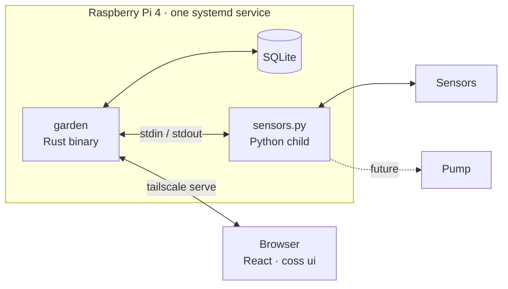
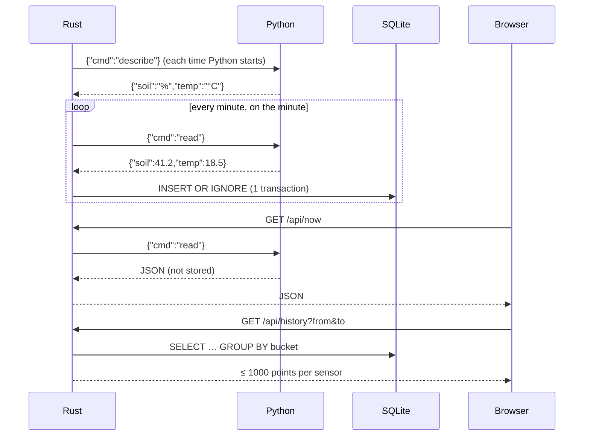

# Garden Monitor — Architecture

A Raspberry Pi 4 reads garden sensors every minute, saves the readings, and runs a website with history charts and a **Read now** button for live values.

**Approach:** keep it simple. One program on the Pi, one file that talks to the hardware, one website. Anything extra waits until it's actually needed (see [Add later](#add-later)).

Words like *reading*, *snapshot* and *bucket* have exact meanings here — see [GLOSSARY.md](GLOSSARY.md). Decisions that might look odd are explained in [docs/adr/](docs/adr/).

## Overview



| Part | What it does | Who works on it |
|---|---|---|
| **Rust program** | The main program. Runs the website, reads sensors every minute, saves data, and keeps the Python script running. | Rust developer |
| **`sensors.py`** | Only talks to the sensors. We use Python here because most sensor libraries are written for it. | Sensors developer |
| **Website** | A React app, built on your PC and copied to the Pi as plain files. It runs in the browser and asks the Pi for data. | Website developer |
| **`db/*.sql`** | The database tables and queries. Rust runs these files as they are. | Database developer |

The Rust ↔ Python messages, the API responses, and the `-- in:` / `-- out:` lines at the top of each SQL file are the agreements between these people. Change them only together.

## Tech stack

| Part | Tool | Why |
|---|---|---|
| Server | Rust (`axum`, `tokio`, `tower-http`) | Very fast, uses little memory (~5–10 MB), ships as one file. |
| Database | SQLite (`rusqlite`) | A single file on the Pi. No separate database server to run. |
| Sensors | Python 3.14 + `uv` | Works with the most sensors. |
| Website | Vite + React + TypeScript + Tailwind v4 + coss ui | Good-looking ready-made components. |
| Charts | uPlot | The fastest chart library for time data (~50 KB). |
| Remote access | Tailscale (`tailscale serve`) | Secure access from anywhere with HTTPS, no router setup and no login code to write. |
| Auto-start | systemd | Built into the Pi. Starts the app on boot and restarts it if it crashes. |

**Memory:** about 30 MB in total (estimate).

## How data moves



1. **Every minute** (at :00): Rust asks Python for a snapshot and saves it. If a read is late, it is skipped, not caught up.
2. **Read now:** Rust asks Python for a live snapshot and sends it to the browser. It isn't saved.
3. **Charts:** Rust reads saved data from SQLite. It never asks Python.

**Time:** Rust stamps the whole snapshot with one time (unix seconds, UTC) when it sends `read`. The Pi has no clock battery, so the app waits for the clock to sync before starting ([ADR 0001](docs/adr/0001-wait-for-clock-sync.md)).

## How Rust and Python talk

Rust starts Python and keeps it running. They exchange one line of JSON each way. There are two commands:

| Rust sends | Python replies |
|---|---|
| `{"cmd":"describe"}` | Each sensor's name and unit: `{"soil":"%","temp":"°C"}` |
| `{"cmd":"read"}` | Each sensor's value: `{"soil":41.2,"temp":null}` (`null` = this sensor failed) |

- **One request at a time:** if a click and the scheduled read happen together, one waits for the other, so the sensors are never read twice at once.
- **If Python hangs or crashes:** after 5 seconds Rust stops it and that snapshot is "unavailable". Python is started again the next time a read is needed (at most once a minute plus clicks), and `describe` is sent again.
- **What Rust accepts:** `null` → nothing saved for that sensor (a gap in the chart). Unknown names and text → dropped and logged. `NaN`/`Inf` aren't valid JSON, so `sensors.py` sends them as `null`. Lines that aren't JSON → logged as warnings and skipped; Rust keeps waiting for the real reply.
- **Which command starts Python:** set by `GARDEN_SENSORS_CMD`. Default on the Pi: `uv run --project sensors python sensors/sensors.py`.

**When choosing sensors,** check two things:
- **How often it can be read:** if it's asked too soon, return the last value instead.
- **Probe corrosion:** soil probes that carry current wear out if always powered. Turn them on only while reading.

### For the sensors developer

You only need to know Python and `sensors.py`:

```python
# sensors.py
import json, sys

UNITS = {"soil": "%", "temp": "°C"}

def read_all() -> dict:
    ...  # read each sensor; if one fails, return None for it instead of crashing

for line in sys.stdin:
    cmd = json.loads(line)["cmd"]
    if cmd == "describe":
        print(json.dumps(UNITS), flush=True)
    elif cmd == "read":
        print(json.dumps(read_all()), flush=True)
```

- **Test it on its own:** `uv run python sensors.py`, then type `{"cmd":"read"}` and press Enter.
- **Debug output goes to stderr:** use `print(..., file=sys.stderr)` or `logging`. Plain `print()` talks to Rust.
- **See errors on the Pi:** `journalctl -u garden -f`
- **After editing, restart:** `sudo systemctl restart garden`. The old code keeps running until you do.
- **Sensor names are permanent.** Renaming `soil` starts a new sensor with no history.
- **`--fake` flag:** `sensors.py --fake` returns random values so the Rust and website developers can work without hardware.

## API

The server listens on `127.0.0.1:8080` only and is reached through `tailscale serve` ([ADR 0002](docs/adr/0002-localhost-behind-tailscale-serve.md)).

| Request | Returns |
|---|---|
| `GET /` | The website |
| `GET /api/now` | Live snapshot (not saved) |
| `GET /api/history?from=<unix s>&to=<unix s>` | Saved readings, averaged to at most 1000 points per sensor |

`/api/now`:
```json
{"ts":1763020800,"sensors":[{"name":"soil","unit":"%","value":41.2},{"name":"temp","unit":"°C","value":null}]}
```
`value: null` = that sensor failed. If Python can't be read at all: `503` with `{"error":"sensors unavailable"}`. Lists only the sensors from the latest `describe`.

`/api/history` (ready for uPlot — one shared time list, values lined up with it, `null` for gaps):
```json
{"bucket":60,"t":[1763020800,1763020860],"sensors":[{"name":"soil","unit":"%","values":[41.2,null]}]}
```
`from` and `to` are required; missing, not a number, or `to <= from` → `400`. `bucket = max(60, ceil((to - from) / 1000))` seconds. Includes every sensor that has data in the range, even old ones.

## Database

All SQL lives in `db/` as plain `.sql` files. Rust builds them into the program (`include_str!`), so there's still one file to copy to the Pi.

```
db/
├── migrations/0001_init.sql   # tables
├── insert_reading.sql
├── upsert_sensor.sql
└── history.sql                # the bucket query
```

**Migrations:** on startup, Rust runs every file in `db/migrations/` numbered above `PRAGMA user_version`, each in its own transaction, then sets `user_version`. Never edit a migration that has already run on the Pi; add a new one.

**Settings** are applied by the program every time it opens the database, not in a migration, because WAL can't be switched on inside a transaction:
```sql
PRAGMA journal_mode = WAL;      -- lets reads and writes happen at the same time
PRAGMA synchronous = NORMAL;    -- fewer slow disk syncs, still safe
PRAGMA foreign_keys = ON;       -- SQLite leaves this off unless asked
```

`0001_init.sql`:
```sql
CREATE TABLE sensors (
  id   INTEGER PRIMARY KEY,
  name TEXT NOT NULL UNIQUE,
  unit TEXT
) STRICT;

CREATE TABLE readings (
  ts        INTEGER NOT NULL,   -- time, unix seconds (UTC)
  sensor_id INTEGER NOT NULL REFERENCES sensors(id),
  value     REAL    NOT NULL,
  PRIMARY KEY (ts, sensor_id)
) STRICT, WITHOUT ROWID;
```

`sensors` rows are added or updated from `describe`. Old sensors and their readings are never deleted.

`history.sql`: averages the readings into time buckets.
```sql
-- in:  :from, :to, :bucket (unix seconds)
-- out: name, unit, t, avg_value  (one row per sensor per bucket that has data, ordered by name, t)
SELECT s.name, s.unit, r.ts / :bucket * :bucket AS t, AVG(r.value) AS avg_value
FROM readings r JOIN sensors s ON s.id = r.sensor_id
WHERE r.ts BETWEEN :from AND :to
GROUP BY r.sensor_id, t
ORDER BY s.name, t;
```

**Why it's small and fast:**
- Rows are stored in time order, so no extra index is needed.
- Each sensor is saved as a small number, not its full name.
- Charts always get about 1000 points, so a year loads as fast as a day.

**Size:** 5 sensors, one reading per minute ≈ **60–70 MB per year** (estimate). No cleanup of old data needed.

### For the database developer

You only need SQL and the `sqlite3` command line:

- **You own `db/`.** Change anything inside a query freely: indexes, rewrites, tuning.
- **The first lines of each query file are an agreement with Rust:**
  ```sql
  -- in:  :from, :to, :bucket
  -- out: name, unit, t, avg_value
  ```
  Changing the inputs or outputs needs the Rust developer.
- **Changing tables:** add a new numbered file in `db/migrations/`. Never edit one that already ran on the Pi.
- **Safety net:** `cargo test` runs your actual `.sql` files, so a breaking change is caught before it reaches the Pi.
- **Try things on a copy:** `sqlite3 copy-of-garden.db`, never the live file.

**First jobs, in order:**
1. Review `0001_init.sql`.
2. Write a test-data script that fills a database with a year of fake readings (a recursive CTE).
3. Check `history.sql` speed over that year of data (`EXPLAIN QUERY PLAN`, and time it on the Pi).
4. Own backup and restore: test that a backup actually opens and has the data.
5. Later: design the `events` table for pump control.

## Folder layout

```
gardening-project-gear-club/
├── server/                 # Rust
│   ├── Cargo.toml
│   └── src/main.rs         # website, schedule, database, runs Python
├── sensors/                # Python
│   ├── pyproject.toml
│   └── sensors.py          # reads the sensors
├── web/                    # React website
│   ├── package.json
│   └── src/
├── db/                     # SQL: migrations + queries (built into the Rust program)
├── deploy/                 # Pi setup (owned by the Rust developer)
│   ├── garden.service      # auto-start config
│   └── garden-backup.*     # nightly backup timer
├── docs/adr/               # why we made certain decisions
├── GLOSSARY.md             # what our words mean
└── garden.db               # created when the app runs
```

## Build and install

| Part | On your PC | On the Pi |
|---|---|---|
| Rust | `cargo zigbuild --release --target aarch64-unknown-linux-gnu` | copy the program |
| Website | `npm run build` | copy `web/dist/` |
| Python | — | copy `sensors/`, run `uv sync` |

**On your PC without sensors:** set `GARDEN_SENSORS_CMD` to run `sensors.py --fake`.

**Pi setup** (once):
1. Use 64-bit Raspberry Pi OS.
2. Add the service user to the `gpio` and `i2c` groups, so sensor libraries work under systemd, not just by hand.
3. Enable `systemd-time-wait-sync`, then enable `garden.service` (it waits for `time-sync.target`).
4. Run `tailscale serve` pointing at `127.0.0.1:8080`.
5. Enable the backup timer.

The program finds `garden.db` and `web/dist/` relative to its working folder (set by `WorkingDirectory` in `garden.service`). On stop, it finishes open requests and stops Python.

## Protecting the SD card

The app writes very little (one small save per minute). SD cards usually fail for other reasons:

| Do | Why |
|---|---|
| Use the official Pi 4 power supply | Low power is the top cause of SD card corruption |
| Use a high-endurance SD card | Made for constant writing, similar price |
| Back up the database every night to another device | So a dead card doesn't lose your data |
| Optional: turn off swap, keep logs in memory, add `noatime` | The system writes far more than the app does |

**Backup:** a systemd timer runs nightly, in two steps:
1. `sqlite3 garden.db ".backup backups/garden-YYYY-MM-DD.db"`: a safe copy on the Pi. Don't copy `garden.db` directly, because with WAL the copy can be broken.
2. Send that copy away from the garden. **Destination not decided yet.** Candidates:
   - **A computer in an office** (e.g. the professor's), reached over Tailscale with `rsync`. That computer must be on at backup time, and the university may need to allow Tailscale on it.
   - **Cloud storage** with `rclone`. Needs an account and its credentials stored on the Pi.

   Either one, or both, is a single extra line in the timer.

## Future: pump control

Not built yet. To add it: a `pump` command in `sensors.py`, a `POST /api/pump` route in Rust, and a new migration adding an `events` table to log it. Tailscale already keeps it private.

## Add later

| Add | When |
|---|---|
| Auto-refresh of live values | You want values to update without clicking (one line of code) |
| Rust sensor code | A sensor has good Rust support and you want to drop Python |
| Cleanup of old data | The database grows past a few GB |
| MQTT | You add wireless sensors elsewhere in the garden |
| USB SSD | The SD card fails, or the app starts writing much more |

**Avoid** server-rendered frameworks. They need Node running on the Pi, for no benefit here.

**Note:** coss ui is still early-stage. Its components are copied into our code, so their updates can't break the site unless we choose to pull them in.
