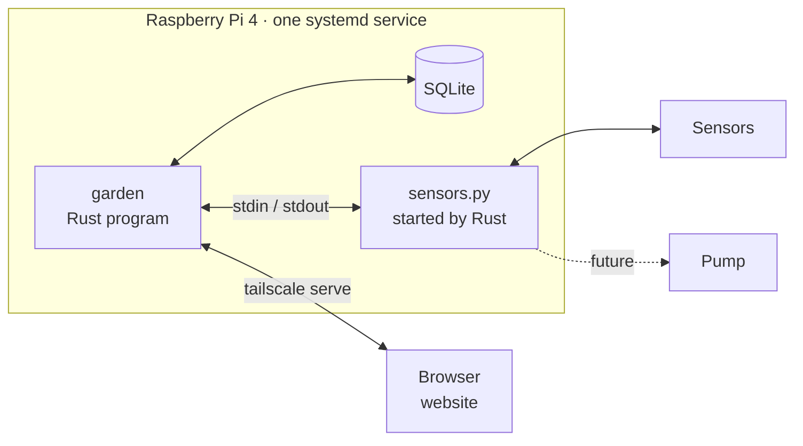
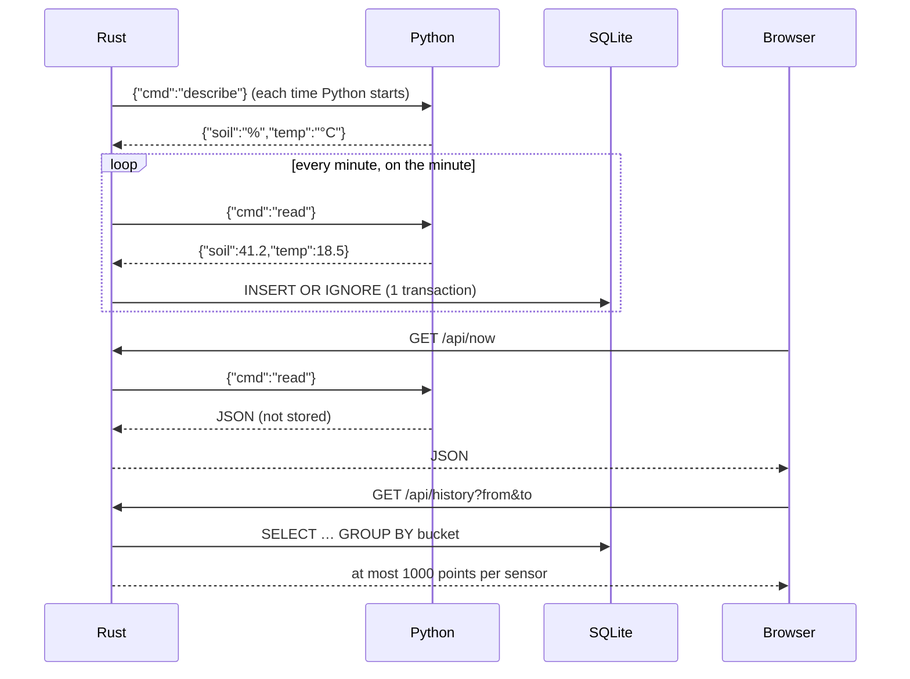

# Garden Monitor architecture

A Raspberry Pi 4 reads the garden sensors every minute, saves the readings, and runs a website. The homepage shows each sensor's latest value on a card, and each card opens a full history chart. Gardening admins also keep a list of the beds and what grows in each.

We keep it simple on purpose. One program runs on the Pi, one Python file talks to the hardware, and the website is plain files. Anything extra waits until we need it, see [Add later](#add-later).

Words like *reading*, *snapshot* and *bucket* have exact meanings, listed in [GLOSSARY.md](GLOSSARY.md). Decisions that might look odd are explained in [docs/adr/](docs/adr/).

## Overview



| Part | What it does | Who works on it |
|---|---|---|
| Rust program, `server/` | The main program. Serves the website and the API, reads the sensors every minute, saves the readings, and keeps the Python script running. | Rust developer |
| `sensors/sensors.py` | Talks to the sensors and nothing else. It's Python because most sensor libraries are written for Python. | Sensors developer |
| Website, `web/` | A website built on a PC and copied to the Pi as plain files, then runs in the browser and asks the Pi for data. | Website developer |
| `db/*.sql` | The tables and queries. Rust runs these files as they are. | Database developer |
| `deploy/` | Scripts and settings that install the app on the Pi. | Rust developer |

Three things are agreements between people, so change them only together: the messages between Rust and Python, the API responses, and the `-- in:` / `-- out:` lines at the top of each SQL file.

## Tech stack

| Part | Tool | Why |
|---|---|---|
| Server | Rust with `axum`, `tokio`, `tower-http` | Uses about 5 to 10 MB of memory and ships as one file. |
| Database | SQLite through `rusqlite` | A single file on the Pi. No database server to run. |
| Sensors | Python 3.13 with `uv` | Most sensor libraries are written for Python. 3.13 is the Python that comes with current Raspberry Pi OS. |
| Website | Not decided yet. See the [suggestion](#suggested-website-stack). | |
| Website tooling | bun | Installs packages and builds the website. Only needed on a PC, never on the Pi. |
| Charts | uPlot | About 50 KB and fast with long time series. |
| Icons | Lucide | Free, consistent icons. Only the icons you use end up in the site. |
| Remote access | Tailscale with `tailscale serve` | Private HTTPS access from anywhere. No router setup and no login code to write. It also tells us who each visitor is, which is how admins are recognised. |
| Auto-start | systemd | Built into the Pi. Starts the app on boot and restarts it if it crashes. |

The whole app should use about 30 MB of memory. That's an estimate, not a measurement.

## How data moves



1. **Every minute**, on the minute, Rust asks Python for a snapshot and saves it. If a minute is missed, Rust skips it and doesn't catch up.
2. **Read now**, an optional button on the website, asks Python for a live snapshot and sends it to the browser. Nothing is saved.
3. **Charts** come from the saved data in SQLite. They never ask Python.

Rust stamps the whole snapshot with one time, in unix seconds UTC, at the moment it sends `read`. The Pi has no clock battery, so after a power cut the app waits until the clock has synced before it starts ([ADR 0001](docs/adr/0001-wait-for-clock-sync.md)).

## How Rust and Python talk

Rust starts Python and keeps it running. Each message is one line of JSON. There are two commands:

| Rust sends | Python replies |
|---|---|
| `{"cmd":"describe"}` | Each sensor's name and unit: `{"soil":"%","temp":"°C"}` |
| `{"cmd":"read"}` | Each sensor's value: `{"soil":41.2,"temp":null}`. `null` means that sensor failed. |

- **One request at a time.** If someone clicks Read now during the scheduled read, one waits for the other. The sensors are never read twice at once.
- **If Python hangs or crashes,** Rust stops it after 5 seconds and that snapshot is lost. Rust starts Python again at the next read and sends `describe` again.
- **What Rust does with the reply.** A `null` value saves nothing for that sensor, which shows as a gap in the chart. Unknown sensor names and non-numbers are dropped and logged. Lines that aren't JSON are logged and skipped, and Rust keeps waiting for the real reply.
- **Which command starts Python.** On the Pi it's `sensors/.venv/bin/python sensors/sensors.py`, using the `.venv` that `uv sync` creates. The environment variable `GARDEN_SENSORS_CMD` overrides it. We don't use `uv run` here, because when Rust stops a hung Python it would only stop `uv`, and the real Python could keep holding the sensors.

When choosing sensors, check two things. First, how often a sensor can be read: if it's asked too soon, return the last value instead. Second, soil probes that carry current corrode if they're always powered, so switch them on only while reading.

### For the sensors developer

You only need Python. Your file is `sensors/sensors.py`, and the parts to edit are `UNITS` (each sensor's name and unit) and `read_all()` (read every sensor and return its value). The loop at the bottom that talks to Rust is already written.

Rules:
- `print()` sends to Rust, so every print must be one JSON reply. Send debug output to stderr with `print(..., file=sys.stderr)` or `logging`.
- If a sensor fails, return `None` for it. Don't let the script crash.
- Sensor names are permanent. Renaming `soil` starts a new sensor with no history.

Try it on your PC, from the `sensors` folder:
```sh
uv run sensors.py --fake
```
Type `{"cmd":"read"}` and press Enter. `--fake` returns random values, which also lets the Rust and website developers work without hardware.

Add a library with `uv add <package>`. Commit both `pyproject.toml` and `uv.lock`, so the Pi installs the same versions. `.python-version` pins Python 3.13 on every machine.

To try your code on the Pi with the real sensors, run this from the project folder on your PC:
```sh
deploy/deploy.sh pi@<pi> sensors
```
It copies your code, installs the libraries and restarts the app. Watch the log with `journalctl -u garden -f` on the Pi.

To run the script by hand on the Pi, stop the app first so two programs don't read the sensors at once:
```sh
sudo systemctl stop garden
cd /opt/garden/sensors && sudo -u garden .venv/bin/python sensors.py
sudo systemctl start garden
```

## API

The server listens only on `127.0.0.1:8080`, and people reach it through `tailscale serve` ([ADR 0002](docs/adr/0002-localhost-behind-tailscale-serve.md)).

| Request | Returns |
|---|---|
| `GET /` | The website |
| `GET /api/now` | A live snapshot, not saved |
| `GET /api/history?from=<unix s>&to=<unix s>` | Saved readings, averaged to at most 1000 points per sensor |
| `/api/me`, `/api/beds`, `/api/plantings` | See [Beds and plantings](#beds-and-plantings) |

`/api/now`:
```json
{"ts":1763020800,"sensors":[{"name":"soil","unit":"%","value":41.2},{"name":"temp","unit":"°C","value":null}]}
```
`"value": null` means that sensor failed. If Python can't be read at all, the reply is `503` with `{"error":"sensors unavailable"}`. Only sensors from the latest `describe` are listed.

`/api/history`:
```json
{"bucket":60,"t":[1763020800,1763020860],"sensors":[{"name":"soil","unit":"%","values":[41.2,null]}]}
```
`t` is one shared list of times and each sensor's `values` line up with it, with `null` for gaps. That's the shape uPlot takes. `from` and `to` are required, and a missing value, a non-number or `to <= from` gives `400`. The bucket size in seconds is `max(60, ceil((to - from) / 1000))`. Every sensor with data in the range is included, old ones too.

### For the website developer

The sensor pages only need the two API calls above. The Plants page uses the routes in [Beds and plantings](#beds-and-plantings). Charts use uPlot and icons use Lucide. Everything else is your choice, with one rule: `bun run build` must produce plain files in `web/dist/`, which the Rust program serves. So no server-rendered frameworks like Next.js. They need a JavaScript runtime on the Pi and gain us nothing.

#### Suggested website stack

If you haven't built a website like this before, this is a safe start. Every tool here is popular, so tutorials and answers are easy to find.

| Tool | Why |
|---|---|
| Vite | Makes the project, runs it while you work, and builds the final files. |
| React | The most used way to build pages from components. Lucide and uPlot both work with it. |
| TypeScript | Catches typos and wrong field names before you open the browser. Plain JavaScript also works if TypeScript feels like too much at first. |
| Tailwind CSS | Style things right in the markup, without writing separate CSS files. |

Create the project once, from the project folder:
```sh
bun create vite web --template react-ts
cd web && bun add uplot lucide-react
```
Use `--template react` for plain JavaScript. Commit `bun.lock` so everyone gets the same package versions.

#### Working with live data

Run the Rust program with fake sensors ([Run it on your PC](#run-it-on-your-pc)), then add this to `vite.config.ts` so `/api` goes to it:
```ts
server: { proxy: { "/api": "http://localhost:8080" } },
```
Start the website with `bun run dev` and open the address it prints.

A history reply goes straight into uPlot:
```ts
const h = await (await fetch(`/api/history?from=${from}&to=${to}`)).json();
const data = [h.t, ...h.sensors.map((s) => s.values)];
```

#### Suggested pages

**Homepage: one card per sensor.** A card shows the sensor's name, its latest value with the unit, a small line of the last 12 hours, and the time of the reading ("updated 14:32"). If that time is more than about 3 minutes old, grey the card out, so a broken sensor or a stopped Pi is obvious. Clicking a card opens its detail page.

Fill the cards from one call, and repeat it every minute, a few seconds after the minute:
```ts
const now = Math.floor(Date.now() / 1000);
const h = await (await fetch(`/api/history?from=${now - 12 * 3600}&to=${now}`)).json();
// for each sensor: the latest value is the last value in h.sensors[i].values that isn't null,
// and its time is the matching entry in h.t
```
For any range up to about 16 hours, `/api/history` returns one point per minute, so that last value is the real latest reading. Don't use `/api/now` for the cards. It reads the sensors live, so every open browser would read them again each minute.

**Detail page: like a stock page on Google Finance.**
- The latest value in large text at the top, and the change over the chosen range as a plain difference, like "+2.1 °C". Not a percent: a percent of soil moisture % is confusing.
- Range buttons: 1D, 1W, 1M, 6M, 1Y. Each button only changes `from`. The reply never has more than 1000 points, so a year loads as fast as a day.
- A uPlot line chart with the value shown on hover.
- Optional: a table of the same points under the chart, newest first.
- Optional: a small **Read now** button that calls `/api/now` to read the sensor at this moment. Show the result, it isn't saved.

A "MAX" range button would need the time of the very first reading, which the API doesn't give yet. Ask the Rust developer when there's more than a year of data.

When it's ready, put it on the Pi with `deploy/deploy.sh pi@<pi> web`.

## Database

All SQL lives in `db/` as plain `.sql` files. Rust builds them into the program with `include_str!`, so there's still only one file to copy to the Pi.

```
db/
├── migrations/
│   ├── 0001_init.sql          # sensors and readings
│   └── 0002_beds.sql          # beds and plantings
├── insert_reading.sql
├── upsert_sensor.sql
├── history.sql                # the bucket query
├── list_beds.sql, find_bed.sql, insert_bed.sql, update_bed.sql, delete_bed.sql
└── list_plantings.sql, find_planting.sql, insert_planting.sql, update_planting.sql, delete_planting.sql
```

On startup, Rust runs every file in `db/migrations/` whose number is above `PRAGMA user_version`, each in its own transaction, then sets `user_version`. Never edit a migration that has already run on the Pi. Add a new one.

The program applies these settings each time it opens the database. They aren't in a migration because WAL can't be switched on inside a transaction.
```sql
PRAGMA journal_mode = WAL;      -- lets reads and writes happen at the same time
PRAGMA synchronous = NORMAL;    -- fewer slow disk syncs, still safe
PRAGMA foreign_keys = ON;       -- SQLite leaves this off unless asked
```

`0001_init.sql`:
```sql
CREATE TABLE sensors (
  id   INTEGER PRIMARY KEY,
  name TEXT NOT NULL UNIQUE,
  unit TEXT
) STRICT;

CREATE TABLE readings (
  ts        INTEGER NOT NULL,   -- time, unix seconds (UTC)
  sensor_id INTEGER NOT NULL REFERENCES sensors(id),
  value     REAL    NOT NULL,
  PRIMARY KEY (ts, sensor_id)
) STRICT, WITHOUT ROWID;
```

Each `describe` adds or updates rows in `sensors`. Old sensors and their readings are never deleted.

`history.sql` averages the readings into time buckets:
```sql
-- in:  :from, :to, :bucket (unix seconds)
-- out: name, unit, t, avg_value  (one row per sensor per bucket that has data, ordered by name, t)
SELECT s.name, s.unit, r.ts / :bucket * :bucket AS t, AVG(r.value) AS avg_value
FROM readings r JOIN sensors s ON s.id = r.sensor_id
WHERE r.ts BETWEEN :from AND :to
GROUP BY r.sensor_id, t
ORDER BY s.name, t;
```

The database stays small and fast for three reasons. Rows are stored in time order, so no extra index is needed. Each reading stores the sensor as a small number, not its name. And charts always get about 1000 points, so a year loads as fast as a day.

Five sensors read once a minute come to roughly 60 to 70 MB a year, so old data never needs cleaning up.

### For the database developer

You only need SQL and the `sqlite3` command line. You own `db/`.

- Change anything inside a query: indexes, rewrites, tuning.
- The first lines of each query file are an agreement with Rust. Changing the inputs or outputs needs the Rust developer.
  ```sql
  -- in:  :from, :to, :bucket
  -- out: name, unit, t, avg_value
  ```
- To change tables, add a new numbered file in `db/migrations/`. Never edit one that already ran on the Pi.
- `cd server && cargo test` runs your actual `.sql` files, so a broken query fails there before it reaches the Pi.
- Experiment on a copy with `sqlite3 copy-of-garden.db`, never on the live file.

First jobs, in order:
1. Review `0001_init.sql`.
2. Write a script that fills a test database with a year of fake readings, using a recursive CTE.
3. Check how fast `history.sql` is over that year, with `EXPLAIN QUERY PLAN` and a timing on the Pi.
4. Own backup and restore. Check that a backup opens and has the data.
5. Later, design the `events` table for pump control.

## Beds and plantings

Gardening admins keep a list of the garden's beds and what is growing in each. Everyone can view it. Only admins can add, edit or remove ([ADR 0003](docs/adr/0003-admins-by-tailscale-identity.md)). The server part is built. The website pages are not started.

A **bed** is one growing area, raised or in the ground. A **planting** is one crop in one bed, from the day it goes in until the day it comes out. When a crop is pulled out, the admin sets its removed date instead of deleting it. That keeps a history of what grew where, and lets the charts mark planting dates later. Delete is only for typing mistakes.

Tables, in `db/migrations/0002_beds.sql`:
```sql
CREATE TABLE beds (
  id       INTEGER PRIMARY KEY,
  name     TEXT NOT NULL UNIQUE,      -- "Bed 3"
  location TEXT NOT NULL DEFAULT '',  -- "north fence, second from the gate"
  notes    TEXT NOT NULL DEFAULT ''
) STRICT;

CREATE TABLE plantings (
  id         INTEGER PRIMARY KEY,
  bed_id     INTEGER NOT NULL REFERENCES beds(id),
  plant      TEXT NOT NULL,             -- "Tomato"
  variety    TEXT NOT NULL DEFAULT '',  -- "Roma"
  planted_on TEXT NOT NULL,             -- "2026-04-15"
  removed_on TEXT,                      -- empty while still growing
  notes      TEXT NOT NULL DEFAULT '',
  changed_by TEXT NOT NULL,             -- Tailscale login of the last admin to edit it
  changed_at INTEGER NOT NULL           -- unix seconds
) STRICT;
```
A bed that still has plantings can't be deleted. The API answers `409` instead.

API:

| Request | Who | Does |
|---|---|---|
| `GET /api/me` | anyone | `{"login":"sam@example.com","admin":true}`. `login` is `null` for someone without Tailscale. The website uses `admin` to show or hide edit buttons. |
| `GET /api/beds` | anyone | All beds |
| `GET /api/plantings` | anyone | All plantings. `?current=1` gives only those still growing. |
| `POST /api/beds`, `POST /api/plantings` | admin | Add one. The body is the new row as JSON. |
| `PATCH /api/beds/:id`, `PATCH /api/plantings/:id` | admin | Change the fields sent in the JSON body |
| `DELETE /api/beds/:id`, `DELETE /api/plantings/:id` | admin | Remove one |

JSON fields use the column names. A bed:
```json
{"id":1,"name":"Bed 3","location":"north fence","notes":""}
```
A planting:
```json
{"id":1,"bed_id":1,"plant":"Tomato","variety":"Roma","planted_on":"2026-04-15","removed_on":null,"notes":"","changed_by":"sam@example.com","changed_at":1763020800}
```
- `POST` takes the same fields without `id`, `changed_by` and `changed_at`, which the server sets. A bed needs `name`. A planting needs `bed_id`, `plant` and `planted_on`. Left-out text fields become `""`, and a left-out `removed_on` becomes `null`. Unknown fields are ignored, so check spelling. The reply is `201` with the new row.
- `PATCH` takes only the fields to change. A field left out stays as it was. `"removed_on":null` clears the removed date, for a crop marked as removed by mistake. The reply is the changed row.
- `DELETE` replies `204` with no body.
- Every planting change stores the admin's login in `changed_by` and the time in `changed_at`.

Rust checks every input. Names and `plant` can't be empty, and spaces around them are trimmed. Dates must be real days written as `YYYY-MM-DD`. `removed_on` can't be before `planted_on`. `bed_id` must be an existing bed.

| Reply | When |
|---|---|
| `400` | Bad input, with a short reason like `{"error":"planted_on must be a real date like 2026-04-15"}` |
| `403` | A viewer tried to change something: `{"error":"admins only"}` |
| `404` | No bed or planting with that id |
| `409` | A bed with that name already exists, or deleting a bed that still has plantings: `{"error":"bed still has plantings"}` |
| `415` | The body isn't sent as `Content-Type: application/json` |

**Admins.** The admin list lives on the Pi in `/etc/garden.env`, never in git:
```sh
GARDEN_ADMINS=sam@example.com,alex@example.com
```
Use each admin's Tailscale login, as shown in the Tailscale admin console. After changing it, run `sudo systemctl restart garden`. Each admin installs the Tailscale app on their phone and signs in once.

**Website.** A Plants page lists the beds and what grows in each, readable on a phone in the garden. Admins also see add, edit and remove buttons with short forms. Later, a sensor card can name its bed, like "Soil · Bed 3 · Tomato".

## Folder layout

```
gardening-project-gear-club/
├── server/                 # Rust
│   ├── Cargo.toml
│   └── src/
│       ├── main.rs         # starts everything, lists the API routes
│       ├── db.rs           # database, migrations, /api/history
│       ├── sensors.rs      # runs sensors.py, every-minute recorder, /api/now
│       └── garden.rs       # beds, plantings, admin check
├── sensors/                # Python
│   ├── pyproject.toml      # libraries; uv.lock pins their versions
│   ├── .python-version     # Python 3.13
│   └── sensors.py          # reads the sensors
├── web/                    # website (not created yet)
├── db/                     # SQL: migrations and queries, built into the Rust program
├── deploy/                 # Pi install, owned by the Rust developer
│   ├── deploy.sh           # run on your PC: build, copy, install, check
│   ├── install.sh          # runs on the Pi, deploy.sh calls it
│   ├── garden.service      # starts the app on boot
│   ├── garden-backup.*     # nightly backup
│   └── setup.md            # how to install on the Pi
├── docs/adr/               # why we made certain decisions
├── GLOSSARY.md             # what our words mean
└── garden.db               # created when the app runs, not committed
```

The program finds `garden.db` and `web/dist/` relative to the folder it runs in. On the Pi that's `/opt/garden`, set by `WorkingDirectory` in `garden.service`. When stopped, it finishes open requests and then stops Python.

## Running and installing

### Run it on your PC

No Pi or sensors needed. From the project folder:
```sh
GARDEN_SENSORS_CMD="python sensors/sensors.py --fake" cargo run --manifest-path server/Cargo.toml
```
Open http://localhost:8080/api/now. This creates `garden.db` in the project folder. Delete it to start fresh.

### Install or update the Pi

```sh
deploy/deploy.sh pi@<pi>
```
This builds everything, copies it to the Pi, installs it and checks that the app answers. Steps and options are in [deploy/setup.md](deploy/setup.md).

The Rust program is built on the PC as a static Linux ARM program (musl), so it runs on any 64-bit Pi OS without matching system libraries. Zig is only the C compiler for SQLite. To build for the Pi, you need these tools on your PC once:
```sh
rustup target add aarch64-unknown-linux-musl
cargo install cargo-zigbuild
winget install zig.zig
```
Building the website also needs bun, and the Pi installs Python through uv by itself.

## Protecting the SD card

The app writes very little, one small save per minute. SD cards usually die for other reasons:

| Do | Why |
|---|---|
| Use the official Pi 4 power supply | Low power is the top cause of SD card corruption. |
| Use a high-endurance SD card | Made for constant writing, at about the same price. |
| Back up the database every night to another device | A dead card then doesn't lose the data. |
| Optional: turn off swap, keep logs in memory, mount with `noatime` | The system writes far more than the app does. |

The backup runs every night at 03:00, or as soon as the Pi is back on if it was off then. It has two steps, both in `deploy/garden-backup.service`:
1. `sqlite3 .backup` makes a safe copy in `/opt/garden/backups/` and keeps the last 7 nights. Never copy `garden.db` with `cp`. With WAL the copy can come out broken.
2. A second command sends the copies away from the garden. We haven't chosen where yet, so both lines are commented out. Uncomment one or both:
   - A computer in an office, such as the professor's, through `rsync` over Tailscale. It has to be on at 03:00, and the university may need to allow Tailscale on it.
   - Cloud storage through `rclone`. This needs an account, with its login stored on the Pi.

## Future: pump control

Not built yet. Adding it takes a `pump` command in `sensors.py`, a `POST /api/pump` route in Rust, and a migration that adds an `events` table to log each run. Only admins may run the pump, using the same check as beds and plantings ([ADR 0003](docs/adr/0003-admins-by-tailscale-identity.md)).

## Add later

| Add | When |
|---|---|
| Live values that refresh on their own | Someone wants values to update without clicking. It's one line of code. |
| Sensor code in Rust | A sensor has good Rust support and we want to drop Python. |
| Cleanup of old data | The database grows past a few GB. |
| MQTT | We add wireless sensors elsewhere in the garden. |
| More roles than admin and viewer | Someone needs a role in between. Move the admin list into a database table. |
| More than 6 viewers | Share the Pi with them from the Tailscale admin console. |
| Public viewing | People without Tailscale should see the site. Turn on Tailscale Funnel, after writing an ADR, because sensor data becomes public too. |
| Photos of plantings | Admins want them. Needs upload size limits and disk space on the Pi. |
| USB SSD instead of the SD card | The SD card fails, or the app starts writing much more. |
