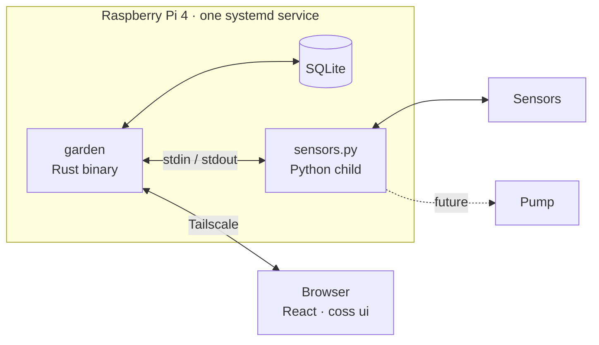
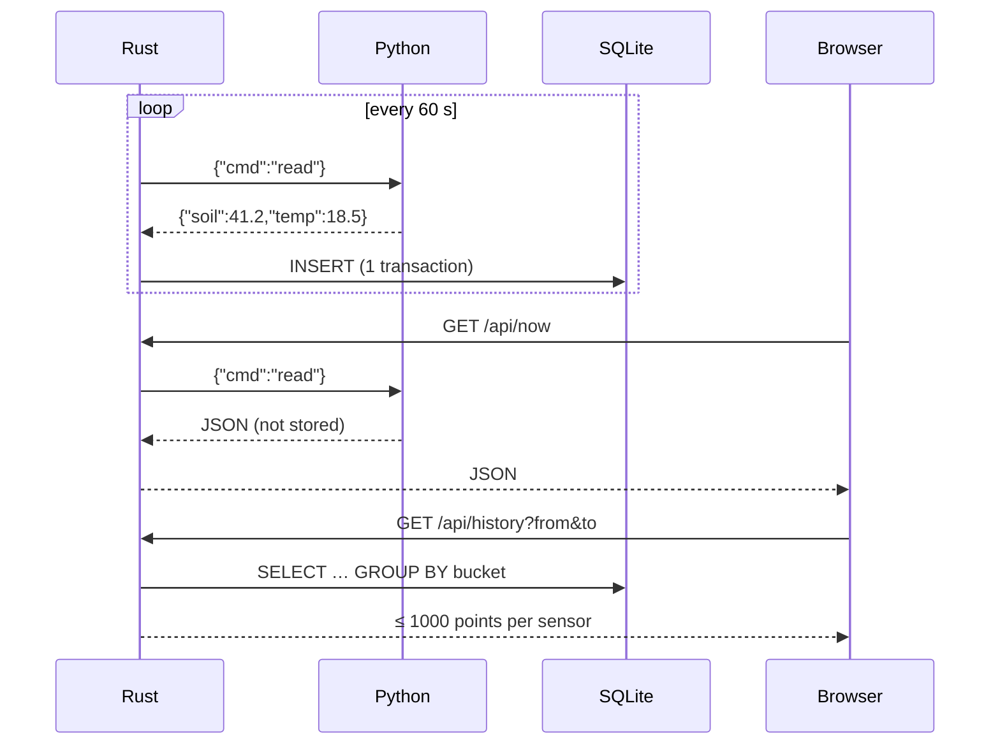

# Garden Monitor — Architecture

A Raspberry Pi 4 reads garden sensors every minute, saves the readings, and runs a website with history charts and a **Read now** button for live values.

**Approach:** keep it simple. One program on the Pi, one file that talks to the hardware, one website. Anything extra waits until it's actually needed (see [Add later](#add-later)).

## Overview



| Part | What it does |
|---|---|
| **Rust program** | The main program. Runs the website, reads sensors every minute, saves data, and keeps the Python script running. |
| **`sensors.py`** | Only talks to the sensors. We use Python here because most sensor libraries are written for it. |
| **Website** | A React app, built on your PC and copied to the Pi as plain files. It runs in the browser and asks the Pi for data. |

## Tech stack

| Part | Tool | Why |
|---|---|---|
| Server | Rust (`axum`, `tokio`, `tower-http`) | Very fast, uses little memory (~5–10 MB), ships as one file. |
| Database | SQLite (`rusqlite`) | A single file on the Pi. No separate database server to run. |
| Sensors | Python 3.14 + `uv` | Works with the most sensors. |
| Website | Vite + React + TypeScript + Tailwind v4 + coss ui | Good-looking ready-made components. |
| Charts | uPlot | The fastest chart library for time data (~50 KB). |
| Remote access | Tailscale | Secure access from anywhere, with no router setup and no login code to write. |
| Auto-start | systemd | Built into the Pi. Starts the app on boot and restarts it if it crashes. |

**Memory:** about 30 MB in total (estimate).

## How data moves



1. **Every minute:** Rust asks Python for a reading and saves it.
2. **Read now:** Rust asks Python for a fresh reading and sends it to the browser. It isn't saved.
3. **Charts:** Rust reads saved data from SQLite. It never asks Python.

## How Rust and Python talk

Rust starts Python once and keeps it running. They exchange one line of text each way:

```python
# sensors.py
import json, sys

def read_all() -> dict:
    ...  # read each sensor; if one fails, return None for it instead of crashing

for line in sys.stdin:
    cmd = json.loads(line)
    if cmd["cmd"] == "read":
        print(json.dumps(read_all()), flush=True)
```

- **One request at a time:** if a click and the scheduled read happen together, one waits for the other, so the sensors are never read twice at once.
- **If Python hangs or crashes:** after 5 seconds, Rust restarts it and shows that reading as "unavailable".
- **Errors** from Python appear in the Pi's system log.

**When choosing sensors,** check two things:
- **How often it can be read:** if it's asked too soon, return the last value instead.
- **Probe corrosion:** soil probes that carry current wear out if always powered. Turn them on only while reading.

## API

| Request | Returns |
|---|---|
| `GET /` | The website |
| `GET /api/now` | Live reading of all sensors (not saved) |
| `GET /api/history?from=<time>&to=<time>` | Saved readings, averaged to at most 1000 points per sensor |

## Database

```sql
PRAGMA journal_mode = WAL;      -- lets reads and writes happen at the same time
PRAGMA synchronous = NORMAL;    -- fewer slow disk syncs, still safe

CREATE TABLE sensors (
  id   INTEGER PRIMARY KEY,
  name TEXT NOT NULL UNIQUE,
  unit TEXT
) STRICT;

CREATE TABLE readings (
  ts        INTEGER NOT NULL,   -- time, unix seconds (UTC)
  sensor_id INTEGER NOT NULL REFERENCES sensors(id),
  value     REAL    NOT NULL,
  PRIMARY KEY (ts, sensor_id)
) STRICT, WITHOUT ROWID;
```

Chart query: averages the readings into time buckets.
```sql
SELECT sensor_id, ts / :bucket * :bucket AS t, AVG(value)
FROM readings WHERE ts BETWEEN :from AND :to
GROUP BY sensor_id, t;
```

**Why it's small and fast:**
- Rows are stored in time order, so no extra index is needed.
- Each sensor is saved as a small number, not its full name.
- Charts always get about 1000 points, so a year loads as fast as a day.

**Size:** 5 sensors, one reading per minute ≈ **60–70 MB per year** (estimate). No cleanup of old data needed.

## Folder layout

```
gardening-project-gear-club/
├── server/                 # Rust
│   ├── Cargo.toml
│   └── src/main.rs         # website, schedule, database, runs Python
├── sensors/                # Python
│   ├── pyproject.toml
│   └── sensors.py          # reads the sensors
├── web/                    # React website
│   ├── package.json
│   └── src/
├── deploy/
│   └── garden.service      # auto-start config
└── garden.db               # created when the app runs
```

## Build and install

| Part | On your PC | On the Pi |
|---|---|---|
| Rust | `cargo zigbuild --release --target aarch64-unknown-linux-gnu` | copy the program |
| Website | `npm run build` | copy `web/dist/` |
| Python | — | copy `sensors/`, run `uv sync` |

Use 64-bit Raspberry Pi OS, then enable `garden.service`.

## Protecting the SD card

The app writes very little (one small save per minute). SD cards usually fail for other reasons:

| Do | Why |
|---|---|
| Use the official Pi 4 power supply | Low power is the top cause of SD card corruption |
| Use a high-endurance SD card | Made for constant writing, similar price |
| Back up the database every night to another device | So a dead card doesn't lose your data |
| Optional: turn off swap, keep logs in memory, add `noatime` | The system writes far more than the app does |

## Future: pump control

Not built yet. To add it: a `pump` command in `sensors.py`, a `POST /api/pump` route in Rust, and an `events` table to log it. Tailscale already keeps it private.

## Add later

| Add | When |
|---|---|
| Auto-refresh of live values | You want values to update without clicking (one line of code) |
| Rust sensor code | A sensor has good Rust support and you want to drop Python |
| Cleanup of old data | The database grows past a few GB |
| MQTT | You add wireless sensors elsewhere in the garden |
| USB SSD | The SD card fails, or the app starts writing much more |

**Avoid** server-rendered frameworks. They need Node running on the Pi, for no benefit here.

**Note:** coss ui is still early-stage. Its components are copied into our code, so their updates can't break the site unless we choose to pull them in.
